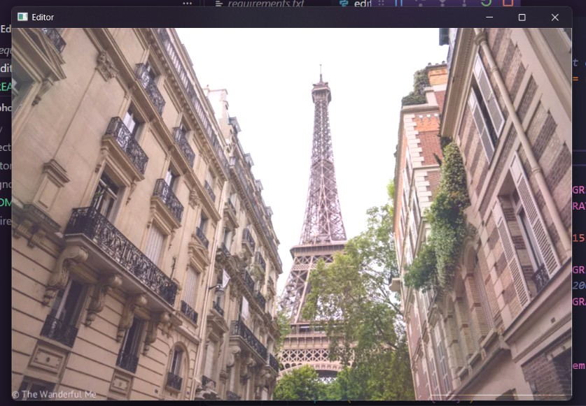
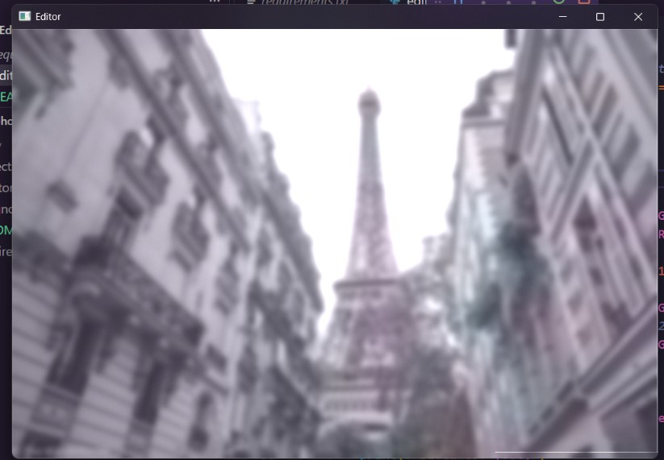

# Mini Photo Editor

A small OpenCV script that loads an image and applies effects
(grayscale, blur, edge detection) with key presses.

 

## Setup

```bat
python -m venv .venv
.venv\Scripts\activate.bat
pip install -r requirements.txt
```

## Run

```bat
python editor.py
```

Drag an image into the terminal window and press Enter.
Click the image window, then use the keys below.

## Controls

- `g` grayscale
- `b` blur
- `e` edge detection
- `r` reset to original
- `s` save as `<name>_edited.jpg` next to the original
- `q` quit

Effects stack: pressing `b` then `e` finds edges in the blurred image.

## Known limitations

- No undo, only reset.
- Blur strength is fixed.
- Large images may open bigger than the screen.
- Closing the window with the X instead of `q` doesn't exit cleanly.

## What I learned


- When debugging I noticed that pressing 'g' twice leads to a crash. This was because the Image, when converted to gray, becomes one channel. And so when you try to input that same 1 channel image into `cvtColor`, which requires a 3 channel input, the program crashed. To fix this after the gray image was made I converted it back to a 3 channel image through `cvtColour(..., ...GRAY2BGR)` after each effect so current was always a 3 channel shape. This was a design choice for consistency.

- Finally I used `.copy()` onto original, to make current. This was because the previous choice, `current = original` didnt copy anything it just set itself to the same array as original. `Blur` and `cvtColor` returned new arrays and so the original image would not be damaged, however in-place edits like `current[0:100, 0:100] = 0` would change both since they both point at the same array. To fix this `current = original.copy()` was used.

## Final comments
I will continue to work on my python skills and similar projects. I will also try to increase my fluency with the cv2 library and using NumPy.